# Hi, I'm Zargham

<picture>
  <source media="(prefers-color-scheme: dark)" srcset="assets/contributions-dark.svg">
  
</picture>

Me, my ideas, and an unreasonable number of AI agents

---

## Built for Fun

- **[AI Radar](https://github.com/zarghammir/ai-radar)**: a morning brief plus a live radar of AI news, research and releases. You can host it yourself, and it needs no paid API. [Live demo](https://ai-radar-blue-delta.vercel.app)
- **Handpan lessons website**: a website I built for a handpan teacher. Students book lessons, pay and follow their progress in their own dashboard. [medyhandpan.com](https://www.medyhandpan.com)
- **[Open CMMS](https://github.com/zarghammir/open-cmms)**: a maintenance management system for facilities, built to the standards of a Canadian government tender. It works in English and French, works offline, and is tested for accessibility. [Live demo](https://workaxis-phi.vercel.app)

---

## AI workspace

How I work with agents: a planning session hands out tickets, builder sessions write the code, reviewer sessions check it, and nothing merges until the tests pass.

### 📁 [skills](https://github.com/zarghammir/skills)

Every skill I use: 7 I wrote and 35 by other people, each with its author's licence, plus links to 5 plugins and tools. Open the folder to see them all.

**★ Picks**

- [superpowers](https://github.com/zarghammir/skills/tree/main/superpowers)
- [ui-standards](https://github.com/zarghammir/skills/tree/main/mine/ui-standards)
- [agent-team-playbook](https://github.com/zarghammir/skills/tree/main/mine/agent-team-playbook)
- [prototype](https://github.com/zarghammir/skills/tree/main/emilkowalski/prototype)
- [impeccable](https://github.com/pbakaus/impeccable)
- [frontend-design](https://github.com/zarghammir/skills/tree/main/anthropic/frontend-design)
- [five-distinct-test](https://github.com/zarghammir/skills/tree/main/mine/five-distinct-test)
- [pr-plain-words](https://github.com/zarghammir/skills/tree/main/mine/pr-plain-words)
- [pr-like-a-pro](https://github.com/zarghammir/skills/tree/main/mine/pr-like-a-pro)
- [graphify](https://github.com/safishamsi/graphify)

